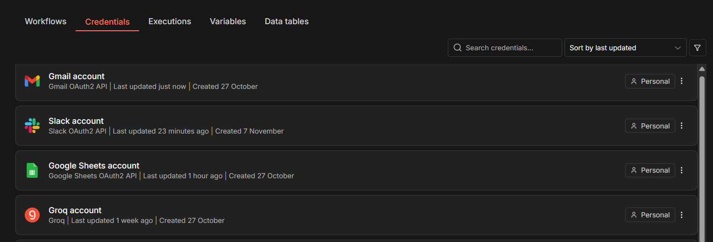

# Checkpoint 4 · Sincronización del cerebro agéntico con el ecosistema de negocio

Workflow de n8n que atiende los correos de clientes de una tienda: filtra auto-respuestas, redacta un borrador con IA, registra al contacto en el CRM sin duplicarlo, avisa al equipo en Slack y deja la respuesta como **borrador** para revisión humana.

Archivo: `checkpoint4_nombre_apellido.json` (importable en n8n: *Workflows → Import from file*).

## Flujo

```
Gmail Trigger → IF (auto-reply) ─Sí→ ignorar
                   │ No
             LLM redacta borrador (Groq)
                   │
             Set (limpia y valida payload)
                   │
             Look up en CRM (Google Sheets: crm_contactos) → IF existe ─No→ Create contacto
                   └────────────────────────────┬─────────────────────────────┘
                                   Set mínimo → Slack (aviso)
                                                │
                                   Gmail Create Draft (HITL)
```

## Las 3 integraciones

| Rol | Herramienta | Operaciones usadas | Mínimo privilegio |
|---|---|---|---|
| Casilla de correo | Gmail (OAuth2) | Trigger de lectura (solo INBOX, no leídos) y **Create Draft** | No se usa la operación *Send*: nada se envía sin un humano |
| CRM | Google Sheets (OAuth2), hoja `crm_contactos` | Read filtrado por `email` y Append | Sin Update ni Delete; solo 5 columnas |
| Canal del equipo | Slack (token de bot) | Post message | Bot con el único scope `chat:write`, invitado solo al canal de operaciones |

### Captura de credenciales



## Controles

- **Bucles (IF tras el trigger):** se ignoran correos cuyo asunto contiene *auto-reply, autoreply, out of office, undeliverable, respuesta automática*, remitentes `no-reply@`, `noreply@`, `mailer-daemon` o sin dirección.
- **Duplicados (409):** `crm_buscar_contacto` consulta por `email` antes de `crm_crear_contacto`; solo se crea si no existe.
- **Payload limpio (400):** el Set `preparar_datos` deja `email`, `nombre`, `asunto`, `mensaje` (≤500 caracteres), `borrador` y `threadId`. Otro Set deja solo el texto del aviso para Slack.
- **Human-in-the-loop:** el correo de salida usa únicamente **Create Draft**; el operador revisa y envía desde Borradores.

## Esquema de la hoja `crm_contactos`

| Columna | Tipo | Uso |
|---|---|---|
| email | texto (clave de búsqueda) | Identificador único del contacto |
| nombre | texto | Nombre del remitente |
| primer_contacto | fecha ISO 8601 | Cuándo se registró |
| ultimo_asunto | texto | Asunto del primer correo registrado |
| estado | texto | NUEVO |
